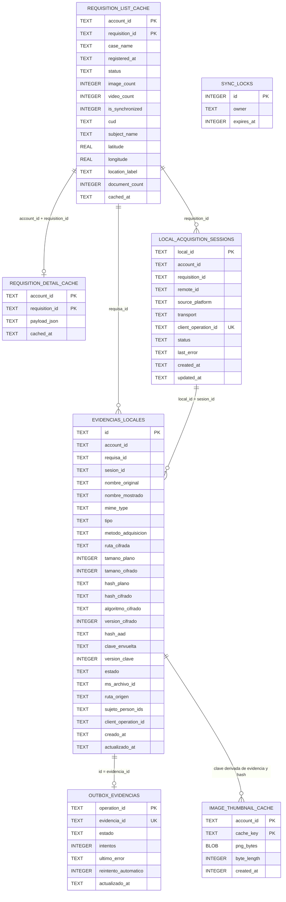
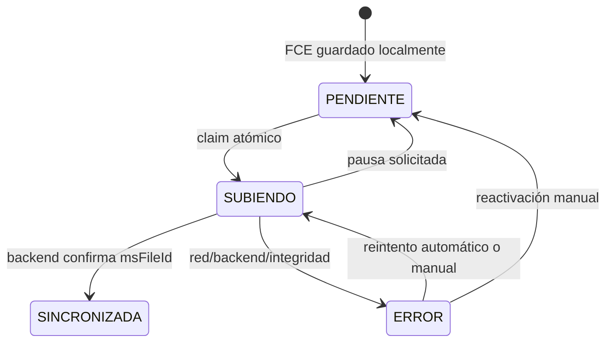
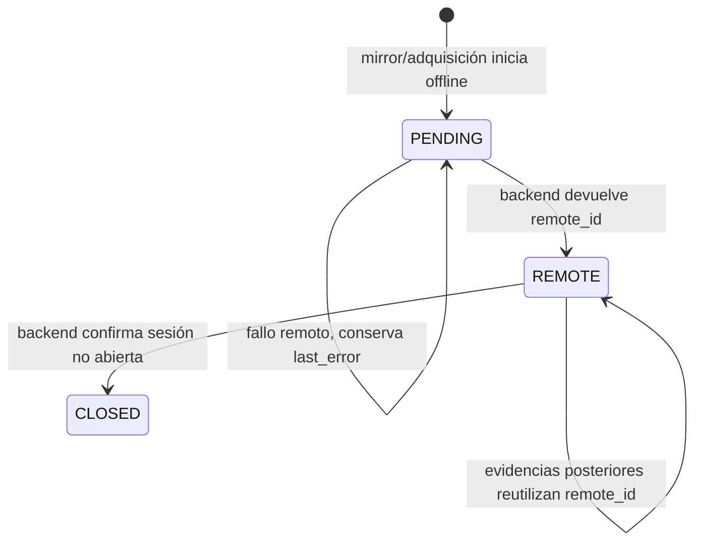
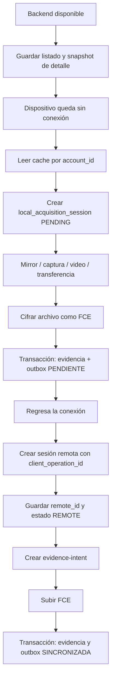

# Base de datos SQLite local de File Cast

Fecha de revisión: 24 de noviembre de 2026
Fuente de verdad del esquema:
[`LocalEvidenceDatabaseService`](../lib/data/services/local_evidence_database_service.dart)

## 1. Resumen

File Cast utiliza una única base SQLite cifrada mediante `sqflite_sqlcipher`.

| Propiedad | Valor |
|---|---|
| Archivo | `file_cast_evidence_v1.db` |
| Versión actual | `10` |
| Motor | SQLite + SQLCipher |
| Ubicación | `getDatabasesPath()` de la plataforma |
| Clave SQLCipher | 32 bytes aleatorios codificados en Base64 URL |
| Almacenamiento de la clave | `FlutterSecureStorage`, clave `file_cast_evidence_database_key_v1` |
| Servicio propietario | `LocalEvidenceDatabaseService` |
| Tablas | 7 |

La base no contiene el archivo original de una evidencia. Los FCE cifrados se
guardan en almacenamiento privado y SQLite conserva su referencia, hashes,
metadatos y estado de sincronización. También guarda miniaturas PNG reducidas
dentro de SQLCipher para evitar regenerarlas después de reiniciar. En iOS, las
nuevas referencias dentro de Documentos son relativas al contenedor de la
aplicación.

## 2. Diagrama entidad-relación



> Las líneas representan relaciones lógicas utilizadas por la aplicación. El
> esquema actual no declara restricciones SQLite `FOREIGN KEY`. Asimismo, no
> existe una tabla local de cuentas: `account_id` proviene del usuario guardado
> en `FlutterSecureStorage` y funciona como partición de seguridad.

## 3. Vista estructural simplificada

```text
Cuenta autenticada (FlutterSecureStorage)
│
├── requisition_list_cache
│   ├── requisition_detail_cache
│   ├── local_acquisition_sessions
│   │   └── evidencias_locales
│   │       └── outbox_evidencias
│   ├── image_thumbnail_cache (PNG reducidos dentro de SQLCipher)
│   └── evidencias_locales recuperadas para uso offline
│
└── sync_locks (lock singleton compartido entre app y WorkManager)

Almacenamiento privado del teléfono
└── evidence_files/<evidenceId>.fce
    └── referenciado por evidencias_locales.ruta_cifrada
```

## 4. Diccionario de tablas

### 4.1 `requisition_list_cache`

Guarda el resumen de las requisas recibidas del backend y permite mostrar,
buscar, filtrar y paginar el listado sin conexión.

Clave primaria compuesta: `(account_id, requisition_id)`.

| Columna | Tipo | Nulo | Descripción |
|---|---|---:|---|
| `account_id` | TEXT | No | Cuenta propietaria del cache. |
| `requisition_id` | TEXT | No | ID de negocio de la requisa. |
| `case_name` | TEXT | No | Nombre o descripción mostrada. |
| `registered_at` | TEXT | No | Fecha de registro ISO-8601 UTC. |
| `status` | TEXT | No | Nombre del `RequisitionStatus` de dominio. |
| `image_count` | INTEGER | No | Cantidad conocida de imágenes. |
| `video_count` | INTEGER | No | Cantidad conocida de videos. |
| `is_synchronized` | INTEGER | No | Booleano SQLite: `1` o `0`. |
| `cud` | TEXT | Sí | CUD asociado. |
| `subject_name` | TEXT | Sí | Sujeto principal. |
| `latitude` | REAL | Sí | Latitud del procedimiento. |
| `longitude` | REAL | Sí | Longitud del procedimiento. |
| `location_label` | TEXT | Sí | Etiqueta legible de ubicación. |
| `document_count` | INTEGER | No | Cantidad de documentos; default `0`. |
| `cached_at` | TEXT | No | Momento de actualización del cache. |

Índice:

```sql
CREATE INDEX requisition_list_cache_account_idx
ON requisition_list_cache(account_id, registered_at DESC);
```

### 4.2 `requisition_detail_cache`

Conserva la respuesta completa del endpoint de detalle. Esto permite reconstruir
el modelo de dominio después de cerrar o reiniciar la aplicación.

Clave primaria compuesta: `(account_id, requisition_id)`.

| Columna | Tipo | Nulo | Descripción |
|---|---|---:|---|
| `account_id` | TEXT | No | Cuenta propietaria del snapshot. |
| `requisition_id` | TEXT | No | Requisa a la que pertenece. |
| `payload_json` | TEXT | No | Envelope JSON completo devuelto por el backend. |
| `cached_at` | TEXT | No | Fecha ISO-8601 UTC del snapshot. |

El JSON es un snapshot para lectura, no una segunda outbox. Las evidencias nuevas
capturadas offline se combinan en memoria con este snapshot leyendo
`evidencias_locales`.

### 4.3 `local_acquisition_sessions`

Permite iniciar mirror, captura, grabación, transferencia o importación sin
esperar que el backend cree una sesión.

| Columna | Tipo | Nulo | Descripción |
|---|---|---:|---|
| `local_id` | TEXT | No | PK con formato `local-session-<uuid>`. |
| `account_id` | TEXT | No | Cuenta que abrió la sesión. |
| `requisition_id` | TEXT | No | Requisa propietaria. |
| `remote_id` | TEXT | Sí | ID asignado por el backend al sincronizar. |
| `source_platform` | TEXT | No | Plataforma de origen, por ejemplo `ANDROID`. |
| `transport` | TEXT | No | Transporte de adquisición, por ejemplo USB/ADB. |
| `client_operation_id` | TEXT | No | Clave idempotente única para crear la sesión remota. |
| `status` | TEXT | No | `PENDING`, `REMOTE` o `CLOSED` después de reconciliar el cierre remoto. |
| `last_error` | TEXT | Sí | Último error de creación remota, truncado a 512 caracteres. |
| `created_at` | TEXT | No | Creación ISO-8601 UTC. |
| `updated_at` | TEXT | No | Última actualización ISO-8601 UTC. |

Restricción única: `client_operation_id`.

Índice:

```sql
CREATE INDEX local_sessions_requisition_idx
ON local_acquisition_sessions(account_id, requisition_id, status);
```

### 4.4 `evidencias_locales`

Es la tabla principal del inventario probatorio local. Registra evidencia nueva
pendiente de subida y evidencia remota descargada como FCE para uso offline.

| Columna | Tipo | Nulo | Descripción |
|---|---|---:|---|
| `id` | TEXT | No | PK de la evidencia; UUID local o ID remoto recuperado. |
| `account_id` | TEXT | No en instalaciones nuevas | Cuenta propietaria. En bases migradas la columna fue agregada en v9. |
| `requisa_id` | TEXT | No | Requisa propietaria. |
| `sesion_id` | TEXT | No | ID de sesión local o remota. |
| `nombre_original` | TEXT | No | Nombre original del archivo. |
| `nombre_mostrado` | TEXT | Sí | Nombre editable mostrado al usuario. |
| `mime_type` | TEXT | No | MIME del contenido original. |
| `tipo` | TEXT | No | `IMAGE`, `VIDEO`, `AUDIO`, `DOCUMENT` u otro tipo backend. |
| `metodo_adquisicion` | TEXT | No | Método: captura, grabación, transferencia o importación. |
| `ruta_cifrada` | TEXT | No | Referencia privada del FCE. En iOS se guarda como `app-documents:evidence_files/<id>.fce` y se resuelve al directorio Documentos actual; las rutas absolutas anteriores se reubican al leerlas. |
| `tamano_plano` | INTEGER | No | Tamaño del contenido antes de cifrar. |
| `tamano_cifrado` | INTEGER | No | Tamaño del FCE cifrado. |
| `hash_plano` | TEXT | No | SHA-256 del contenido original. |
| `hash_cifrado` | TEXT | No | SHA-256 del FCE. |
| `algoritmo_cifrado` | TEXT | No | Algoritmo de cifrado. |
| `version_cifrado` | INTEGER | No | Versión del formato criptográfico. |
| `hash_aad` | TEXT | No | Hash de los datos autenticados asociados. |
| `clave_envuelta` | TEXT | No | Clave de datos envuelta para almacenamiento local. |
| `version_clave` | INTEGER | No | Versión de la clave. |
| `estado` | TEXT | No | Estado local de la evidencia. |
| `ms_archivo_id` | TEXT | Sí | ID confirmado por ms-files-v2. |
| `ruta_origen` | TEXT | Sí | Ruta o referencia del origen de adquisición. |
| `sujeto_person_ids` | TEXT | No | Arreglo JSON de IDs de personas; default `[]`. |
| `client_operation_id` | TEXT | No | Idempotencia de la carga del archivo. |
| `creado_at` | TEXT | No | Fecha ISO-8601 UTC de creación. |
| `actualizado_at` | TEXT | No | Última actualización ISO-8601 UTC. |

Índices:

```sql
CREATE INDEX evidencias_locales_requisa_idx
ON evidencias_locales(account_id, requisa_id, creado_at);

CREATE INDEX evidencias_locales_account_idx
ON evidencias_locales(account_id, requisa_id, creado_at);
```

El segundo índice se crea durante la migración v9. En una instalación creada
directamente en v9, ambos tienen las mismas columnas y uno resulta redundante.

### 4.5 `outbox_evidencias`

Representa la operación durable de subida asociada a una evidencia local. Se
inserta en la misma transacción que `evidencias_locales`.

| Columna | Tipo | Nulo | Descripción |
|---|---|---:|---|
| `operation_id` | TEXT | No | PK; coincide con el `client_operation_id` al crear la fila. |
| `evidencia_id` | TEXT | No | Relación lógica única con `evidencias_locales.id`. |
| `estado` | TEXT | No | `PENDIENTE`, `SUBIENDO`, `ERROR` o `SINCRONIZADA`. |
| `intentos` | INTEGER | No | Número de fallos registrados; default `0`. |
| `ultimo_error` | TEXT | Sí | Último mensaje seguro, máximo 512 caracteres. |
| `reintento_automatico` | INTEGER | No | `1` permite worker automático; `0` deja la fila pausada. |
| `actualizado_at` | TEXT | No | Última transición ISO-8601 UTC. |

Restricción única: `evidencia_id`, por lo que existe como máximo una operación
de carga por evidencia.

Índice:

```sql
CREATE INDEX outbox_evidencias_estado_idx
ON outbox_evidencias(estado, actualizado_at);
```

### 4.6 `sync_locks`

Mutex durable entre el isolate principal y WorkManager. Evita que ambos reclamen
la misma fila de la outbox al mismo tiempo.

| Columna | Tipo | Nulo | Descripción |
|---|---|---:|---|
| `id` | INTEGER | No | PK con `CHECK (id = 1)`; sólo puede existir una fila. |
| `owner` | TEXT | No | Identificador de la ejecución propietaria. |
| `expires_at` | INTEGER | No | Expiración de la lease en epoch milliseconds. |

La lease dura 10 segundos. Si un isolate muere, otra ejecución puede recuperar
el lock cuando `expires_at` vence.

### 4.7 `image_thumbnail_cache`

Caché derivada para mostrar imágenes sin volver a descifrar y decodificar el
archivo original tras un reinicio. Está dentro de SQLCipher y separada por
`account_id`; la clave incorpora ID, ruta y metadatos de integridad de la
evidencia. No contiene el archivo original.

| Columna | Tipo | Nulo | Descripción |
|---|---|---:|---|
| `account_id` | TEXT | No | Cuenta propietaria. |
| `cache_key` | TEXT | No | SHA-256 de la identidad y versión de la evidencia. |
| `png_bytes` | BLOB | No | Miniatura PNG de hasta 384 píxeles en su lado mayor. |
| `byte_length` | INTEGER | No | Tamaño del PNG para controlar la cuota. |
| `created_at` | INTEGER | No | Momento de inserción en microsegundos UTC. |

Clave primaria `(account_id, cache_key)` e índice por `(account_id, created_at)`.
La caché conserva como máximo 128 elementos y 40 MiB por cuenta; no inserta
miniaturas individuales mayores de 2 MiB. Al superar el límite elimina primero
las entradas más antiguas. Si falta una miniatura, se regenera desde el FCE.

## 5. Relaciones y reglas de integridad

### Relaciones principales

| Origen | Destino | Cardinalidad | Aplicación |
|---|---|---|---|
| `requisition_list_cache` | `requisition_detail_cache` | 1 a 0..1 | Misma cuenta y requisa. |
| `requisition_list_cache` | `local_acquisition_sessions` | 1 a N | Una requisa puede tener varias sesiones históricas. |
| `requisition_list_cache` | `evidencias_locales` | 1 a N | Inventario FCE local de la requisa. |
| `local_acquisition_sessions` | `evidencias_locales` | 1 a N | `local_id` se guarda temporalmente en `sesion_id`. |
| `evidencias_locales` | `outbox_evidencias` | 1 a 0..1 | Sólo evidencia pendiente tiene operación de subida. |

### Integridad aplicada por código

- listado, detalle, sesiones y evidencias se consultan con el `account_id` de
  la cuenta autenticada;
- sesión y evidencia se validan contra el mismo `requisition_id` antes de subir;
- evidencia y outbox se insertan juntas dentro de una transacción;
- una evidencia recuperada del backend se marca `SINCRONIZADA` y no genera
  outbox;
- una evidencia confirmada se actualiza junto con su outbox dentro de una
  transacción;
- `sync_locks` protege únicamente la reserva/cambio de estado; la red ocurre
  fuera del lock para no bloquear nuevas capturas.

## 6. Máquinas de estado

### Evidencia y outbox



Una fila `SUBIENDO` con más de 15 minutos se considera abandonada y vuelve a
`ERROR` antes de reclamar el siguiente lote.

### Sesión de adquisición local



## 7. Flujo offline y sincronización



## 8. Migraciones conocidas

| Versión | Cambio relevante |
|---:|---|
| 1 | Tablas iniciales de evidencia y outbox. |
| 2 | `metodo_adquisicion` en evidencias. |
| 3 | `sync_locks`. |
| 4–5 | Compatibilidad/reintento de outbox; la migración actual garantiza `reintento_automatico`. |
| 6 | `nombre_mostrado`. |
| 7 | `sujeto_person_ids`. |
| 8 | Cache de requisas, cache de detalle y sesiones locales. |
| 9 | `account_id` en evidencias e índice por cuenta/requisa. |
| 10 | Caché cifrada y acotada de miniaturas de imagen. |

Las migraciones de columnas usan `PRAGMA table_info` antes de ejecutar
`ALTER TABLE`, de modo que una migración previamente interrumpida no repita una
columna ya creada.

## 9. Datos fuera de SQLite

| Dato | Ubicación | Motivo |
|---|---|---|
| Clave de SQLCipher | `FlutterSecureStorage` | No guardar la clave junto a la base. |
| Tokens y usuario autenticado | `FlutterSecureStorage` | Sesión y partición `account_id`. |
| Binarios FCE | Almacenamiento privado del dispositivo, normalmente `evidence_files/<id>.fce` | Evitar BLOB grandes en SQLite y conservar importaciones y descargas offline entre reinicios. |
| Staging temporal | Almacenamiento privado/temporal | Cifrado previo a persistencia definitiva. |
| Handles ADB/scrcpy | Memoria/proceso nativo | No son restaurables ni serializables. |

## 10. Limitaciones actuales del esquema

1. Las relaciones son lógicas; no existen `FOREIGN KEY` ni cascadas.
2. `account_id` no referencia una tabla local de cuentas.
3. El snapshot de detalle es un JSON completo, por lo que no permite consultas
   SQL finas sobre participantes, sujetos o sesiones remotas.
4. La outbox sólo modela subida de evidencias; todavía no existe una outbox
   genérica para tombstones, cambios de permisos o conflictos versionados.
5. No existen tablas de chunks, receipts ni ledger de custodia append-only.
6. No existe una tabla de cuotas, reservas de espacio o política de retención.
7. `evidencias_locales_requisa_idx` y `evidencias_locales_account_idx` son
   redundantes en instalaciones nuevas v9; una migración futura puede consolidar
   ambos después de medir planes de consulta.
8. El cierre remoto se reconcilia como `CLOSED`, pero todavía no existe una
   intención local de cierre/cancelación offline en una outbox genérica.

Estas limitaciones no impiden guardar y consultar el trabajo offline actual,
pero sí delimitan los siguientes incrementos de integridad, sincronización y
operación descritos en `OFFLINE_MODE_IMPLEMENTATION_PLAN.md`.
